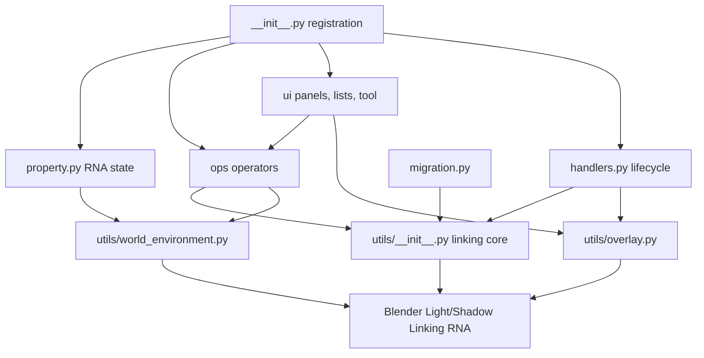

# LightHelper Project Context

## Purpose

LightHelper is a Blender 4.2+ Extension for managing native Light Linking and
Shadow Linking from either a light or a receiving object. It also treats Cycles
emissive meshes and a managed World-environment dome as linkable sources.

## Architecture

- `__init__.py`: registration entry point; registers preferences, RNA
  properties, operators, UI, translations, and handlers.
- `property.py`: object, scene, and window-manager state for linking modes,
  pinning, solo snapshots, the interactive tool, and World environment data.
- `preferences.py`: sidebar, filtering, view movement, duplicate repair, and
  interactive overlay preferences.
- `utils/__init__.py`: core link collection operations, source detection,
  duplicate/single-user handling, safe helpers, cache invalidation, and common
  Blender data utilities.
- `ops/`: panel linking, object-first linking, interactive-tool actions, EV and
  solo controls, selection, maintenance, and World conversion operators.
- `ui/`: sidebar panels, UI lists, and the 3D View Light Linking tool.
- `utils/overlay.py`: GPU link lines, outlines, HUD drawing, picking, caching,
  and depsgraph/undo redraw integration.
- `utils/world_environment.py`: Cycles World graph discovery and managed
  inward-dome material/object lifecycle.
- `handlers.py` and `migration.py`: load/undo/redo/depsgraph maintenance and
  legacy managed-data migration.
- `translation/`: Simplified Chinese UI translations.

## Main Workflows

1. A source is initialized with receiver/blocker collections and an
   Include/Exclude linking mode.
2. Panel or interactive-tool operators add/remove objects or collections in
   the illumination and shadow channels. In Light-subject mode, Shift-clicking
   an emissive mesh toggles it as a target without changing the current source.
3. Object-first UI resolves the inverse relationship and edits each source's
   channels without changing the subject object.
4. The overlay cache visualizes active links and refreshes for relevant object,
   collection, tool, undo, and depsgraph changes.
5. Cycles World conversion preserves the original World and creates one
   managed emissive dome per scene, including Sun isolation records.

## Constraints

- Keep compatibility with Blender 4.2+ and both Cycles/Eevee capability gaps;
  emissive-mesh and World environment linking are Cycles-only.
- Preserve user-authored or library-linked Blender data. Only delete or mutate
  data with verified LightHelper ownership/provenance.
- Blender RNA access and mutation must remain on Blender's main thread.
- Store per-item `AddonPreferences` UI indexes in declared RNA properties;
  Blender 5.2 does not support using IDProperties on that type.
- Keep extension identity `LightHepler` despite the historical spelling.
- `AGENTS.md` and `PROJECT_CONTEXT.md` are development-only and must not enter
  the extension archive.
- The working tree may contain intentional uncommitted work; do not reset it.

## Verification

```powershell
ruff check .
python -m compileall -q -f .
git diff --check
& $BlenderExe --background --factory-startup --command extension validate
& $BlenderExe --background --factory-startup --command extension build --output-dir .\dist
```

For Blender behavior, use isolated user config/data/extensions roots and
`--python-exit-code 1`. Validate at the minimum supported version and the
current target version, then inspect the ZIP contents for excluded development
files and required runtime files.

## Current Risks

- The branch has a large uncommitted refactor; review diffs before overlapping
  edits.
- The working tree adds unified library-linked/read-only checks and truthful
  link-write results; real linked-library and override behavior still needs
  Blender verification.
- The working tree restores a surviving Solo snapshot when its light was
  deleted; the delete-then-solo interaction still needs Blender verification.
- Release metadata still reports 2.1.1; maintainer email, icon licensing,
  bundled GPL license, and wider CI coverage remain release decisions.

## Knowledge Graph


