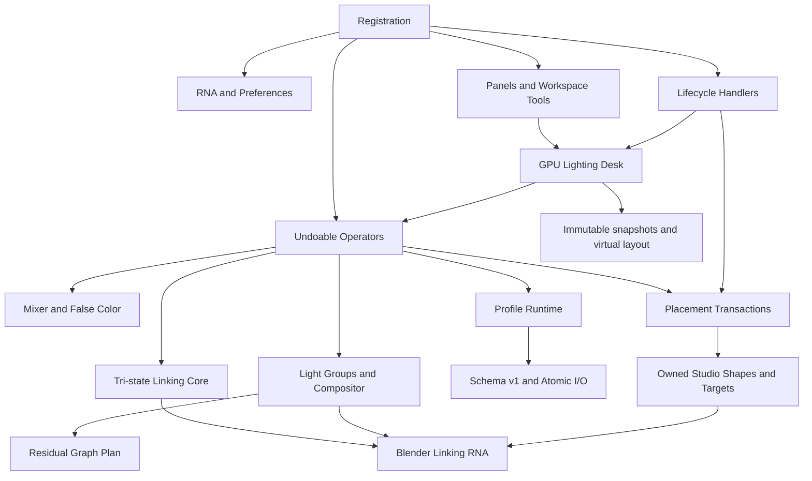

# LightHelper Project Context

## Purpose

LightHelper is a Blender 4.2+ Extension for non-destructive lighting work. It
combines native Light/Shadow Linking, a full-area Lighting Desk, light mixing
and placement, portable Lighting Profiles, Cycles Light Groups, World Dome
linking, and managed studio-shaping objects.

## Architecture

- `__init__.py`: registration entry point. Registration order is preferences,
  RNA properties, operators, UI/tools, translations, then lifecycle handlers.
- `property.py` and `preferences.py`: persistent Object/Scene data plus
  `SKIP_SAVE` WindowManager session flags and Desk defaults.
- `utils/__init__.py`: native linking core, including `ChannelState`, direct and
  inherited state resolution, Simple/Advanced conversion, provenance, and
  compatibility wrappers.
- `ui/desk.py`, `utils/desk_layout.py`, `ops/desk.py`: immutable Desk snapshots,
  virtualized GPU layout, per-window/area modal ownership, and undoable sibling
  operations.
- `ops/light_mixer.py`: Minimal/Normal/Advanced mixer data, batch operations,
  Kelvin conversion, safe copy/paste, collection EV/tint, and temporary False
  Color restoration.
- `utils/placement.py`, `ops/placement.py`, `ui/placement_tool.py`: pure
  Reflect/Direct/Orbit math and the transactional 3D toolbar placement tool.
- `utils/studio.py`, `ops/studio.py`: owned Scrim, Flag, Reflector, Studio
  Collection, Track Target, data isolation, and conservative cleanup.
- `core/profiles.py`, `utils/profile_runtime.py`, `ops/profiles.py`: schema-v1
  `.lhprofile` validation, stable references, atomic I/O, capture, and
  match-only or explicit create-missing apply.
- `core/light_group_plan.py`, `utils/light_groups.py`, `ops/light_groups.py`:
  cross-version View Layer Light Groups and the managed residual compositor.
- `utils/overlay.py`: real per-channel overlay colors and dual-width lines.
- `utils/world_environment.py`: owned Cycles environment dome conversion and
  protected Sun exclusions.
- `handlers.py`: load/undo/redo cleanup, Kelvin metadata sync, Studio duplicate
  isolation, cache lifecycle, and optional duplicate-linking repair.

## Main Workflows

1. A source can stay in Simple mode or enter Advanced mode. Advanced edits each
   receiver/blocker entry as Off, Include, or Exclude. Returning to Simple
   requires an explicit Include/Exclude choice and preserves World internals.
2. Lighting Desk fills only the current `VIEW_3D/WINDOW`; Link virtualizes both
   matrix axes, Mix edits selected lights, Looks manages Profiles/False Color/
   Light Groups, and Studio creates owned shaping objects.
3. Light Placement creates or adjusts Point, Area, Spot, Sun, Scrim, Flag, or
   Reflector targets. Each gesture restores the original target or deletes only
   its newly created target when cancelled.
4. Profiles use UUIDs for editable local IDs and library path plus `name_full`
   for read-only linked IDs. Apply never deletes unrelated scene data and only
   creates native lights, a managed World Dome, or managed Studio objects when
   `Create Missing` is explicit.
5. The Cycles compositor computes
   `Combined - sum(raw groups) + sum(group * 2^EV * tint)`. All managed nodes
   carry owner/role metadata; user-authored output links are preserved.

## Constraints

- Keep Blender 4.2+ support and capability-detect 5.x APIs such as direct Light
  Group removal, compositor root groups, and Light `normalize`.
- Cycles is the complete physical target. Eevee supports native lights and
  Flags; existing Scrim/Reflector data is preserved without helper-light fakes.
- Preserve read-only/library data and user node chains. Mutate or remove only
  data whose LightHelper owner and role are verified.
- Blender RNA access and mutation stay on the main thread. GPU draw callbacks
  consume immutable snapshots and never write RNA.
- Desk and Placement owners are keyed by window/area pointer, use no idle timer,
  redraw only their owner WINDOW region, and clean up idempotently.
- Keep extension ID `LightHepler` and manifest version `2.1.1` until a separate
  release decision.
- `AGENTS.md`, `PROJECT_CONTEXT.md`, tests, caches, profiles, QA artifacts, and
  nested archives must not enter the Extension ZIP.

## Verification

```powershell
ruff check --no-cache .
# Compile source text in memory; do not create bytecode in the repository.
& $Blender42 --background --factory-startup --python-exit-code 1 --python tests/blender_linking_states.py
& $Blender42 --background --factory-startup --python-exit-code 1 --python tests/blender_desk_smoke.py
& $Blender42 --background --factory-startup --python-exit-code 1 --python tests/blender_placement_studio_smoke.py
& $Blender42 --background --factory-startup --python-exit-code 1 --python tests/blender_profile_aov_smoke.py
git diff --check
& $BlenderExe --background --factory-startup --command extension validate
& $BlenderExe --background --factory-startup --command extension build --output-dir .\dist
```

Run background coverage on 4.2, 4.5, 5.0, and 5.2. Foreground QA uses isolated
Blender user roots and covers both 4.2 and 5.2 without terminating user Blender
processes. Inspect every produced ZIP explicitly.

The latest unified background run passed all six smoke scripts on Blender
4.2.1, 4.5.3, 5.0.1, and 5.2.0. Source validation, Extension build, ZIP
validation, and ZIP entry audit passed on 4.2.1 and 5.2.0.

## Current Risks

- Foreground mouse/DPI/theme, nested file-browser handoff, dual-window owners,
  100 x 300 matrix responsiveness, and foreground Undo/Redo remain visual QA;
  background Blender has no Window/Area context for those checks.
- Real linked-library and library-override link targets require final Blender
  behavior verification even though mutation guards and skip reports exist.

## Knowledge Graph


